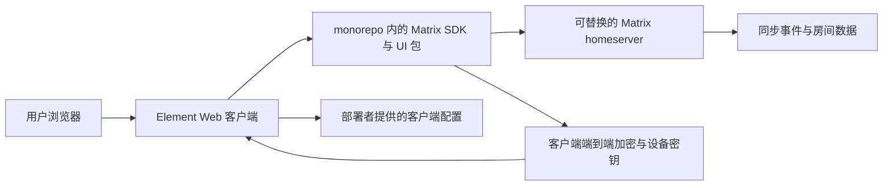

# Element Web · Recipkg

**Matrix 即时通讯网页客户端：房间、消息、加密和自托管配置。**

[Recipkg 标准库](https://github.com/recipkg/standard-library) · [上游 v1.12.33](https://github.com/element-hq/element-web/releases/tag/v1.12.33) · [配方](RECIPE.md) · [构建要求](BUILD_PROMPT.md) · [验收计划](ACCEPTANCE.md) · [覆盖状态](COVERAGE.md)

> 当前状态：提取中。固定来源与已知缺口见 [`COVERAGE.md`](COVERAGE.md)；验收计划尚未执行。

## 系统边界

Matrix homeserver 是可替换的外部运行服务。此配方记录客户端边界，不把 homeserver、数据库或推送服务混进 Element Web 的实现范围。

## 文件

- [`RECIPE.md`](RECIPE.md)：目标范围和递归依赖。
- [`BUILD_PROMPT.md`](BUILD_PROMPT.md)：交给实现 Agent 的重建要求。
- [`ACCEPTANCE.md`](ACCEPTANCE.md)：未来运行时验收计划。
- [`SOURCES.md`](SOURCES.md)：固定上游版本、许可和查阅文件。
- [`COVERAGE.md`](COVERAGE.md)：观察证据、未知范围和当前阶段。

配方归档只含 UTF-8 Markdown；打包会固定并递归包含质量、设计依赖。它不包含 Element Web 源码，也不声称已经重建出兼容客户端。
